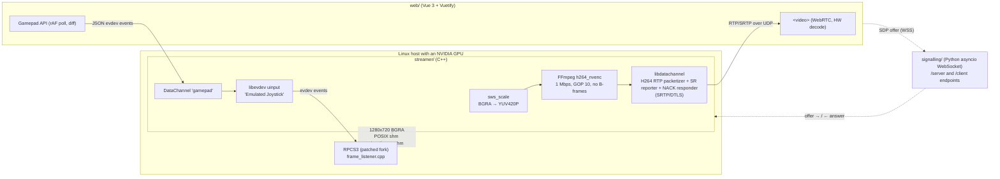

# cloudstation3

Play PS3 games in a browser: a patched RPCS3 emulator renders on a Linux GPU box, a C++ streamer encodes the frames with NVENC and sends them over WebRTC, and the browser's Gamepad API sends controller input back over a DataChannel to a virtual uinput joystick.

- **Demo video:** https://youtu.be/Ei86aeKOFcs
- **Player UI (static build):** https://cloudstation3.vercel.app. It only plays something while a streamer host is online.

> This is a personal tech demo, not a service. No games, ROMs, BIOS or firmware are included or linked. Use only games and firmware you have legally dumped from hardware you own.

## Architecture



The same flow as text:

```
RPCS3 ──memcpy──▶ /vectframe_shm (3.7 MB BGRA) ──mmap──▶ streamer
                                                   ├─ sws_scale BGRA→YUV420P
                                                   ├─ h264_nvenc (FFmpeg)
                                                   └─ libdatachannel H264 RTP ──SRTP/UDP──▶ browser <video>
browser Gamepad API ──DataChannel "gamepad"──▶ streamer ──libevdev uinput──▶ virtual joystick ──▶ RPCS3
browser ──SDP offer──▶ wss://…/client ─▶ signalling ─▶ /server ─▶ streamer ──SDP answer──▶ back the same way
```

How signalling works: the browser creates the offer (a recvonly video transceiver plus a `gamepad` DataChannel), waits until ICE gathering completes (no trickle ICE), and sends the full SDP to `/client`. The signalling server forwards `{client_id, offer}` to the one streamer connected on `/server`. Offers that arrive before the streamer connects are queued. The streamer answers with `{client_id, answer}` and the server relays the answer back and closes that client's socket. After that, media and input go peer-to-peer. The player also has a "no signalling server" mode, where you copy and paste the offer and answer by hand.

### Emulator side (not vendored)

The capture hooks live in my public RPCS3 fork, [fortune-max/rpcs3](https://github.com/fortune-max/rpcs3). They hook into `rpcs3/util/media_utils.cpp` (the emulator's recording path) and write each video frame into `/vectframe_shm` and audio samples into `/vectsample_shm`:

| Date | Commit | Change |
|---|---|---|
| 2024-07-08 | [`7c6aa1a`](https://github.com/fortune-max/rpcs3/commit/7c6aa1a6310f6353fed644cefe0aa1a67a9eec2f) | add frame_listener (`util/frame_listener.cpp`, `media_utils.cpp` hook) |
| 2024-07-13 | [`63e647f`](https://github.com/fortune-max/rpcs3/commit/63e647f1d890170cc583d310a257002634c1c5a6) | working streamer video frames |
| 2024-07-13 | [`b47cade`](https://github.com/fortune-max/rpcs3/commit/b47cadee425efbe942f4e1012e45e7ff068fefbf) | add sample listener (`util/sample_listener.cpp`) |
| 2024-07-13 | [`1905802`](https://github.com/fortune-max/rpcs3/commit/1905802059e2fa01c623b38c44ac9eac78f8e6aa) | sample listener with AVFrame |
| 2024-07-13 | [`5236ad0`](https://github.com/fortune-max/rpcs3/commit/5236ad08a9bccaadbd71a862d4206a99a97ef57b) | update sampler |

## Repository layout

| Path | What | Origin (history preserved) |
|---|---|---|
| `streamer/` | C++17 streamer: shm reader, swscale, NVENC, libdatachannel WebRTC, uinput joystick. `min_producer.cpp`/`min_consumer.cpp` are the early shm + semaphore proofs of concept (not built by CMake). | `fortune-max/frame-streamer`, Jul–Sep 2024 |
| `web/` | Vue 3 + Vuetify player: WebRTC receiver, gamepad mapping, connection state and FPS readout. | `fortune-max/rpcs3-ui`, Jul–Sep 2024 |
| `signalling/` | Python asyncio WebSocket signalling server, Dockerfile, Let's Encrypt DNS-01 notes. | `fortune-max/certbot-assist`, Sep 2024 |
| `prototype-joystream/` | Nov 2023 prototype of the input path: Gamepad API → WebSocket → Python `evdev` uinput. | `fortune-max/joystream`, Nov 2023 |

## Build and run

These steps come from the code and scripts in each folder. Some values are hardcoded for the original deployment (see Known limitations).

### streamer (Linux and NVIDIA only)

Requirements: CMake ≥ 3.28, a C++17 compiler, FFmpeg dev libraries built with `h264_nvenc` (libavcodec, libavformat, libavutil, libswscale), libevdev (found through pkg-config) and nlohmann_json. libsrtp v2.5.0 and libdatachannel v0.21.2 are downloaded by CMake `FetchContent`.

```sh
cd streamer
cmake -B build && cmake --build build      # produces build/frame_streamer
sudo ./build/frame_streamer                # needs write access to /dev/uinput
```

Start the patched RPCS3 first: the streamer exits if `/vectframe_shm` does not exist. The streamer connects to `wss://ws.cloudstation3.com/server` (hardcoded in `main.cpp`). It sits idle until a browser connects.

### signalling

```sh
cd signalling
pip install -r requirements.txt            # websockets==12.0
python signaling_server.py 0.0.0.0:8000    # arg: [host:]port, default 127.0.0.1:8000
# or
docker build -t cs3-signalling . && docker run -p 80:80 cs3-signalling
```

The server speaks plain `ws://`. The deployed endpoint was served as `wss://` (TLS in front of it). An earlier revision did TLS itself with a Let's Encrypt certificate, which `signalling/README.md` explains how to get through a manual DNS-01 challenge. Endpoints: `/server` (streamer), `/client` (browser), `/reset`.

### web

```sh
cd web
npm install
npm run dev        # Vite dev server
npm run build      # vue-tsc type-check + production build
```

### prototype-joystream

```sh
cd prototype-joystream
sudo -E python3 evdev_server.py   # WebSocket on 0.0.0.0:8765, creates a uinput gamepad (needs python-evdev, websockets)
npm install && npm run dev        # set the server IP in src/components/GamePad.vue
```

## Design decisions & trade-offs

**Shared memory instead of a socket between emulator and streamer.** One 1280×720 BGRA frame is 1280·720·4 ≈ 3.7 MB, which is about 92 MB/s at 25 fps. That rate is too much to push through a pipe or a localhost socket. With POSIX shared memory, the emulator `memcpy`s each frame into a mapped region and the streamer maps the same pages read-only. No frame bytes cross the kernel, and there is no serialisation step. The streamer then makes one local copy before conversion. The region holds a single slot, so backpressure is "latest frame wins": a slow encoder drops frames instead of building up latency. The cost is that there is no frame-ready signal or sequence number. The streamer reads whatever is in the slot, so it can re-encode the same frame or catch one that is half written. (The early `min_producer`/`min_consumer` proof of concept used a pair of semaphores. The production path does not use them, so the emulator never blocks on the streamer.)

**WebRTC instead of MJPEG or video over a WebSocket.** WebRTC sends media as RTP over UDP. A lost packet does not stall later packets the way TCP head-of-line blocking does. The browser adds a jitter buffer, congestion control and hardware H.264 decode. RTCP gives feedback both ways: the streamer attaches libdatachannel's `RtcpNackResponder`, which retransmits lost packets, and an `RtcpSrReporter`, which sends sender reports for A/V clock mapping. H.264 at about 1 Mbps also needs far less bandwidth than MJPEG at the same quality. Controller input goes over a DataChannel on the same peer connection, so input and video share one NAT traversal and one DTLS session.

**NVENC tuned for low latency.** The encoder settings are `h264_nvenc`, 1 Mbps, 25 fps time base, `max_b_frames = 0`, `gop_size = 10`. With no B-frames the encoder never waits for future frames. The short GOP (a keyframe every 0.4 s) means a new viewer, or a viewer who lost packets, recovers quickly without a PLI path. The cost is that keyframes are much larger than P-frames, so every 10th frame produces a bitrate spike that can add queueing delay on thin links. Possible improvements: intra-refresh, which spreads the I-blocks over several frames, or a long GOP with keyframes only on demand when the receiver sends RTCP PLI/FIR (not implemented here).

**STUN only, no TURN.** Both peers use `stun.l.google.com:19302`. Server-reflexive candidates are enough for typical home NATs. They fail when both sides sit behind symmetric NAT, and on networks that block UDP. Those cases need a TURN relay, ideally over TCP/TLS 443. If the streamer host has a public IP, its host candidate is directly reachable, so most clients can connect even from behind their own NAT. TURN still matters for UDP-blocked clients.

## Known limitations & next steps

- **Frame pacing:** the streamer loop copies the shm slot, encodes, then sleeps 10 ms. It has no "new frame" signal. Next: a seqlock or frame counter in the shm header, plus an `eventfd`/futex wakeup, so it encodes each frame exactly once with no tearing.
- **Audio is captured but not streamed:** the fork writes samples to `/vectsample_shm`, but the streamer has no audio track yet (Opus over RTP would be the natural next step).
- **No TURN server** (see above).
- **Fixed bitrate:** no adaptive bitrate from REMB/TWCC feedback.
- **Single shared session:** the streamer accepts several viewers, but they all get the same encoded stream and a single shared virtual joystick. Isolating users would need one emulator + streamer container per session.
- **Hardcoded settings:** resolution (1280×720), the shm name and the signalling URL are compile-time constants.
- **Latency not yet measured:** there is no glass-to-glass or input-to-photon measurement yet, so this README makes no latency claims.

## Legal

cloudstation3 is a technical demo of streaming and input plumbing. It does not include and does not link to any copyrighted games, ROMs, BIOS or firmware. RPCS3 is a separate GPL-2.0 project; only links to my fork's commits are given here.
